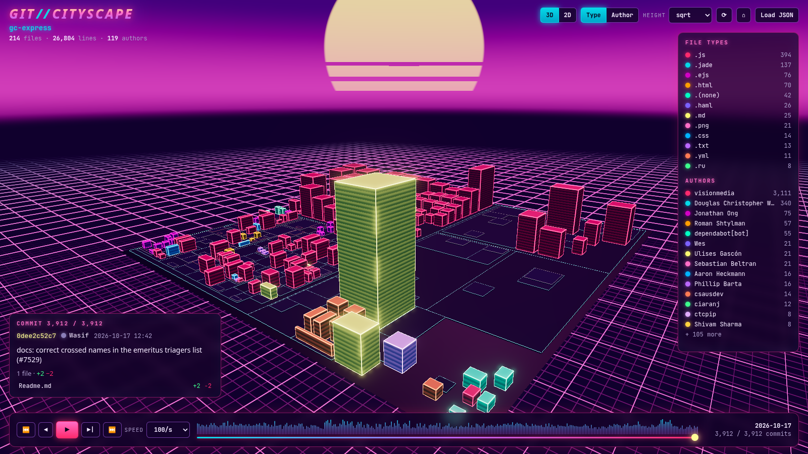
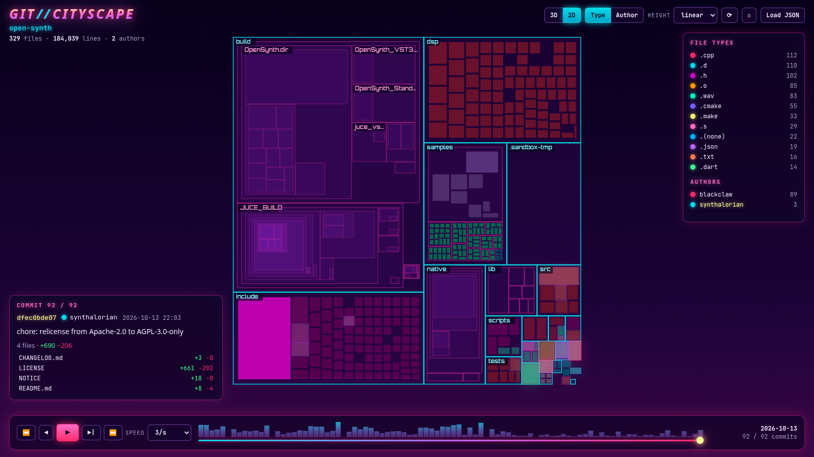
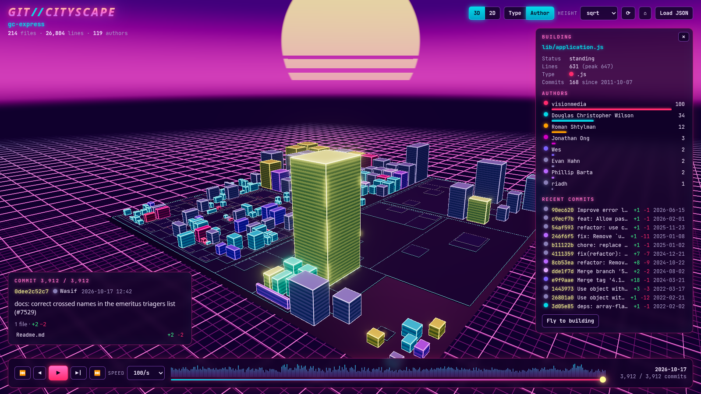

# git-cityscape

**Your Git history as a neon synthwave city.**

`git-cityscape` turns a repository into a 3D city: directories become districts, files become
buildings, and the skyline grows, shrinks and lights up as you scrub through every commit.
A fast TypeScript CLI extracts the history into a compact JSON file, and a Three.js web app
renders it under a striped retro sun with a glowing grid floor.



## Features

- **Fast extraction.** A single streamed `git log --raw --numstat -z` pass handles 10k commits in
  about 2 seconds. It understands renames (`{old => new}` and `-z` forms), binary files (`-`),
  deletions and merges (first-parent diffs by default).
- **Compact output.** A JSON file with an author table, a path table and commit tuples. Per-file
  line counts are stored as deltas and replayed in the browser.
- **Remote repositories.** Pass a Git URL and the CLI makes a bare clone into a temp directory,
  then removes it (also on Ctrl+C). Blobless clones are available with `--blobless`.
- **3D city** (Three.js, `InstancedMesh`):
  - squarified-treemap districts
  - building height follows line count (sqrt by default, with linear and log options), capped at a quarter of the city width
  - footprint follows the square root of the line count
  - bloom, fog, a gradient sky, a striped sun and an animated grid floor
- **Timeline:**
  - scrubber with an activity histogram
  - play/pause, step and speed controls
  - seeking uses snapshots every N commits, so jumping to any point in a 10k-commit history is
    instant
- **Recent activity glows.** Buildings changed in recent commits pulse and bloom.
- **Two color modes:** by file type (extension) or by last author, with legends for both.
- **Inspector.** Click a building to see its path, line count (current and peak), type,
  authors, and recent commits (rename history included). Click a commit there to jump to it.
- **Commit panel.** Shows the hash, author, date, message and changed files of the current
  commit.
- **2D treemap view.** A canvas rendering of the same layout, with pan and zoom.
- **Flexible loading:** `?data=history.json`, drag-and-drop, or a file picker. A demo dataset
  is bundled.
- **Deep links:** `?view=2d&color=author&height=log&commit=120&file=src/app.ts&speed=30&play=1`.

## Screenshots

| 3D city | 2D treemap |
| --- | --- |
|  |  |



## Setup

Requirements: **Node.js ≥ 20.19** and **git ≥ 2.31** on your `PATH`.

```bash
git clone <this repository> git-cityscape
cd git-cityscape
npm install
npm run build        # compiles the CLI (dist/node) and the web app (dist/web)
npm link             # optional: puts `git-cityscape` on your PATH
```

## Usage

### CLI

```bash
# Extract a local repository
git-cityscape extract ~/code/my-project -o history.json

# Extract a remote repository (bare clone into a temp dir, removed afterwards)
git-cityscape extract https://github.com/user/repo.git -o repo.json

# Only the most recent 5000 commits; earlier state is folded into a baseline commit
git-cityscape extract . --max-commits 5000 -o history.json

# Extract and serve the web app with the data (http://localhost:4173/?data=history.json)
git-cityscape serve ~/code/my-project --port 4173 --open
```

| Option | Commands | Description |
| --- | --- | --- |
| `-o, --output <file>` | extract, demo | Output path (`-` for stdout). Default `history.json` |
| `--max-commits <n>` | extract, serve | Keep the newest *n* commits, plus a baseline snapshot of everything before them |
| `--rev <revision>` | extract, serve | Single revision (branch, tag or commit) to walk (default `HEAD`). Ranges are rejected; use `--max-commits` to limit history |
| `--blobless` | extract, serve | Clone remotes with `--filter=blob:none`. Smaller download, but git fetches blobs lazily while diffing, so extraction is slower |
| `--pretty` | extract, demo | Indent the JSON |
| `-q, --quiet` | extract, serve | No progress output |
| `-p, --port <n>` | serve | Port (default `4173`) |
| `--host <host>` | serve | Interface to bind (default `127.0.0.1`) |
| `--open` | serve | Open the browser |

`git-cityscape demo -o demo.json` writes a synthetic history. `npm run demo:data` uses it to
regenerate the bundled demo.

Without `npm link`, run the CLI as `node bin/git-cityscape …` or `npx git-cityscape …` from
the project directory.

### Web app

- `npm run dev` starts Vite on http://localhost:4173 with the bundled demo.
  Put a `history.json` in `web/public/` and open `/?data=history.json` to view your own.
- Or open the built app (`dist/web`) and drag a `history.json` onto the page.

| Input | Action |
| --- | --- |
| Drag / right-drag / wheel | Orbit / pan / zoom (3D); pan / zoom (2D) |
| Click | Inspect a building |
| Double-click | Fly to a building (3D) / reset zoom (2D) |
| `Space` | Play / pause |
| `←` `→` (`Shift` ×10) | Step through commits |
| `Home` / `End` | First / last commit |
| `T` | Toggle 3D / 2D |
| `C` | Toggle color by type / author |
| `R` | Auto-rotate |
| `Esc` | Close the inspector |

## Data format

```jsonc
{
  "version": 1,
  "repo": "my-project",
  "generatedAt": "2026-10-22T12:00:00.000Z",
  "baseline": true,                  // present when --max-commits cut the history
  "authors": ["Ada", "Linus"],
  "files": ["src/a.ts", "src/b.ts", "logo.png"],
  "commits": [
    // [unixSeconds, authorIdx, subject, shortHash, changes]
    [1700000000, 0, "init", "1a2b3c4d5e", [[0, 120, 0], [2, -1, -1]]],
    // change: [fileIdx, added, deleted, from?]
    //   from >= 0  -> renamed from files[from]
    //   from == -1 -> file deleted
    //   from == -2 -> content replaced by text with exactly `added` lines (binary -> text)
    //   added == deleted == -1 -> binary file
    [1700003600, 1, "move a -> b", "6f7a8b9c0d", [[1, 4, 2, 0]]]
  ]
}
```

## Architecture

```
bin/git-cityscape      Node entry point (loads dist/node/cli/index.js)
src/core/              Shared, dependency-free TypeScript
  parser.ts            Streaming numstat parser (-z and text modes) + HistoryBuilder
  replay.ts            Replayer: incremental state, snapshots every N commits, per-file history
  treemap.ts           Squarified treemap + hierarchical district layout
  types.ts             Compact history format
  demo.ts              Deterministic synthetic history for the demo
src/cli/               CLI: argument parsing, git extraction, remote cloning, static server
web/                   Vite app (index.html, public/demo.json)
  src/model.ts         Replayer + stable layout + color tables shared by both views
  src/city3d.ts        Three.js scene: instanced buildings, shaders, bloom, picking
  src/treemap2d.ts     Canvas 2D treemap view
  src/main.ts          UI wiring: timeline, panels, legend, loading, keyboard
tests/                 vitest: parser, replay/snapshots, treemap layout, real-git extraction
```

**Extraction.** The CLI spawns one
`git log --first-parent --diff-merges=first-parent -M --raw --numstat -z` process and
parses its stdout incrementally as a stream of NUL-delimited tokens. Paths and header fields
are consumed by position, so no byte in a message or filename can break the framing. Numstat
gives the line deltas; raw entries identify deletions (including binary files) and the new
blob of each change. When git reports a binary numstat for a file that was already binary,
the new blob is inspected with `git cat-file --batch` so binary-to-text conversions get an
exact line count. With `--max-commits`, a single `git diff --numstat` from the empty tree to
the window's parent produces a baseline commit, so line counts stay exact.

**Replay.** `Replayer` applies commits to typed arrays: lines, existence, last author and last
change per file. While loading, it walks the whole history once to:

- take a snapshot every N commits
- record each file's peak size
- build per-file commit lists and rename links

Seeking restores the nearest snapshot and applies at most N commits. Stepping forward applies
commits incrementally.

**Layout.** Lots come from a squarified treemap of the directory tree, weighted by
√(peak lines) and computed once, so buildings keep their place while history plays. A
building's height follows its current line count, and its footprint shrinks within its lot
as the file shrinks. Single-child directory chains (`src/main/java`) collapse into one
district.

**Rendering.** All buildings live in one `InstancedMesh`. A patched `MeshStandardMaterial`
adds per-instance glow (an instanced attribute), window bands and roof highlights.
`UnrealBloomPass` makes the glow bloom. Each frame, instance matrices ease toward their target
heights. The 2D view draws the same layout on a canvas.

## Development

```bash
npm run dev          # Vite dev server (web app)
npm test             # vitest
npx tsc --noEmit     # type-check everything
npm run build        # CLI + web build
```

## License

[MIT](LICENSE) © 2026 synthalorian
